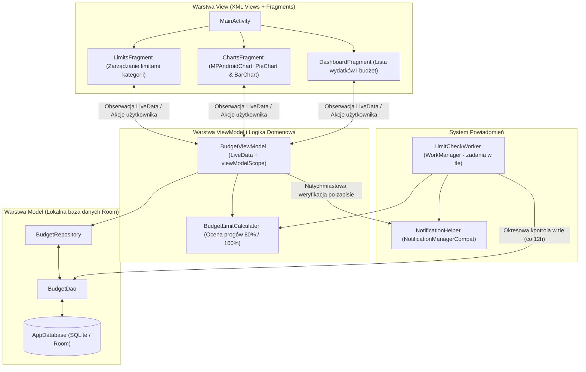
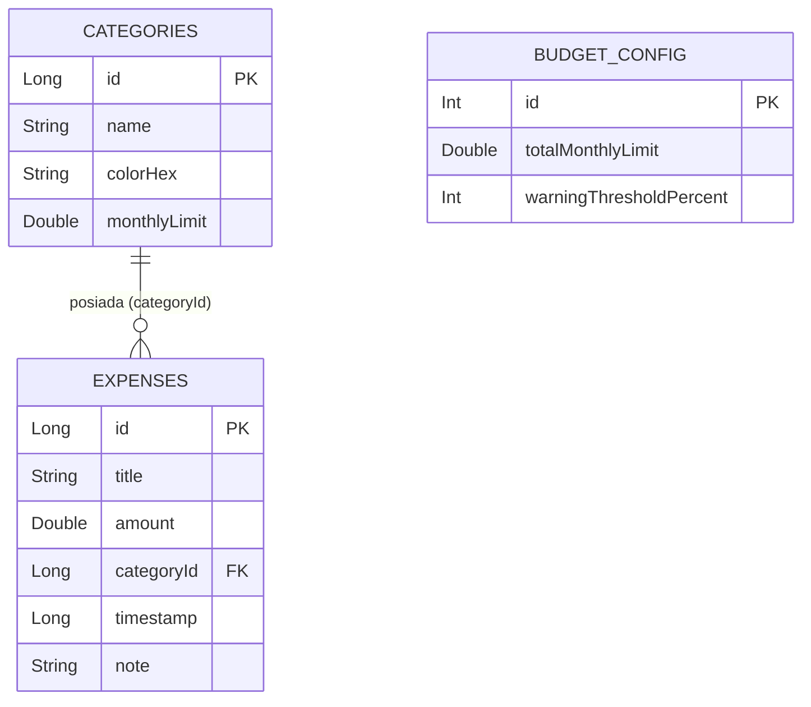
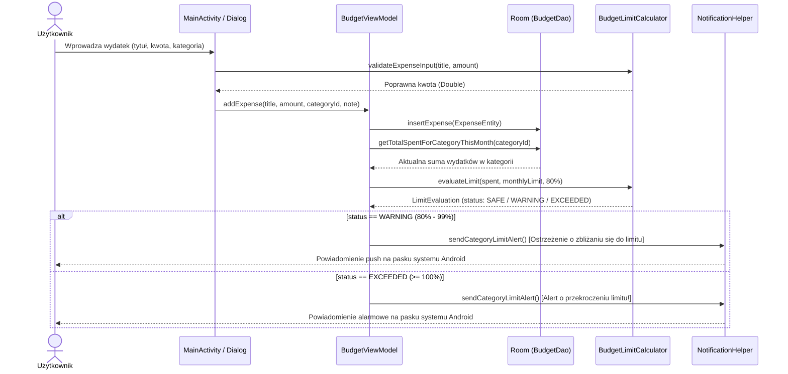

# Tworzenie mobilnej aplikacji do zarządzania finansami osobistymi z systemem powiadomień w oparciu o limity wydatków (Android, Kotlin)

**Uczelnia:** Uniwersytet WSB Merito we Wrocławiu  
**Autorka:** Valeriia Vlasova (Numer albumu: 96669)  
**Projekt aplikacji:** `SmartBudżet` ([FinanseOsobiste](file:///C:/Users/LizKind/.gemini/antigravity/scratch/FinanseOsobiste))

---

## Spis treści

1. [Wstęp](#wstęp)
2. [Cel i zakres pracy](#cel-i-zakres-pracy)
3. [Rozdział 1. Wstęp teoretyczny i analiza dziedziny](#rozdział-1-wstęp-teoretyczny-i-analiza-dziedziny)
   - [1.1. Analiza istniejących rozwiązań (konkurencji)](#11-analiza-istniejących-rozwiązań-konkurencji)
   - [1.2. Współczesne podejścia do kontroli finansów osobistych i systemów powiadomień](#12-współczesne-podejścia-do-kontroli-finansów-osobistych-i-systemów-powiadomień)
   - [1.3. Przegląd stosu technologicznego i architektury aplikacji](#13-przegląd-stosu-technologicznego-i-architektury-aplikacji)
4. [Rozdział 2. Implementacja (Część praktyczna)](#rozdział-2-implementacja-część-praktyczna)
   - [2.1. Architektura aplikacji i technika projektowania](#21-architektura-aplikacji-i-technika-projektowania)
   - [2.2. Konfiguracja lokalnej bazy danych Room do przechowywania wydatków i kategorii](#22-konfiguracja-lokalnej-bazy-danych-room-do-przechowywania-wydatków-i-kategorii)
   - [2.3. Realizacja systemu limitów wydatków i powiadomień (NotificationManager i WorkManager)](#23-realizacja-systemu-limitów-wydatków-i-powiadomień-notificationmanager-i-workmanager)
   - [2.4. Wizualizacja danych oraz interfejs użytkownika (XML Views, Fragments, MPAndroidChart)](#24-wizualizacja-danych-oraz-interfejs-użytkownika-xml-views-fragments-mpandroidchart)
5. [Rozdział 3. Testowanie](#rozdział-3-testowanie)
   - [3.1. Testy jednostkowe i instrumentalne (Unit & Room Tests)](#31-testy-jednostkowe-i-instrumentalne-unit--room-tests)
   - [3.2. Testowanie funkcjonalne głównych możliwości aplikacji](#32-testowanie-funkcjonalne-głównych-możliwości-aplikacji)
   - [3.3. Ocena użyteczności interfejsu (UI/UX) oraz skuteczności aplikacji](#33-ocena-użyteczności-interfejsu-uiux-oraz-skuteczności-aplikacji)
6. [Rozdział 4. Podsumowanie](#rozdział-4-podsumowanie)
7. [Bibliografia](#bibliografia)
8. [Spis ilustracji (rysunków)](#spis-ilustracji-rysunków)
9. [Spis tabel](#spis-tabel)

---

## Wstęp

We współczesnym świecie, charakteryzującym się wysoką dostępnością płatności bezgotówkowych, kart zbliżeniowych, mikropłatności mobilnych oraz subskrypcji cyfrowych, bieżąca kontrola nad wydatkami osobistymi stała się jednym z najczęstszych wyzwań życia codziennego. Pozorna łatwość dokonywania transakcji sprawia, że konsumenci często tracą poczucie realnej skali wydawanych środków w ujęciu miesięcznym. Brak systematycznego monitorowania drobnych, codziennych kosztów prowadzi do niezamierzonego przekraczania założonego budżetu oraz trudności w gromadzeniu oszczędności.

Wybrałam ten temat, ponieważ w moim codziennym życiu często napotykam trudności w kontrolowaniu wydatków. Staram się trzymać określonego budżetu, ale często przekraczam jego granice, ponieważ trudno mi samodzielnie śledzić swoje finanse. Tradycyjne metody, takie jak gromadzenie papierowych paragonów czy prowadzenie arkuszy kalkulacyjnych na komputerze, okazują się w praktyce zbyt czasochłonne i niewygodne w momencie dokonywania zakupu. Dlatego pomysł stworzenia mobilnej aplikacji, która pomagałaby kontrolować wydatki i przypominała o osiągnięciu limitów finansowych, jest dla mnie aktualny, użyteczny i osobiście motywujący.

Główną ideą niniejszej pracy dyplomowej jest zaprojektowanie oraz implementacja natywnej aplikacji mobilnej **SmartBudżet** dla systemu Android, która łączy prostotę codziennego rejestrowania transakcji z aktywnym, zautomatyzowanym systemem ostrzegania użytkownika. W odróżnieniu od pasywnych rejestratorów kosztów, opracowane rozwiązanie nie tylko zapisuje historię operacji w lokalnej bazie danych i prezentuje ją na czytelnych wykresach, lecz przede wszystkim reaguje w czasie rzeczywistym na zmiany w budżecie — wysyłając powiadomienia systemowe w chwili zbliżania się do ustalonego progu (80% limitu) oraz w momencie jego przekroczenia (100% limitu).

---

## Cel i zakres pracy

**Celem głównym pracy** jest zaprojektowanie, implementacja oraz przetestowanie aplikacji mobilnej na platformę Android napisanej w języku Kotlin, wspomagającej zarządzanie finansami osobistymi poprzez kategoryzację wydatków, wizualizację danych oraz proaktywny system powiadomień oparty na definiowanych przez użytkownika limitach budżetowych.

**Zakres pracy** obejmuje następujące etapy badawcze i inżynierskie:
1. Omówienie nowoczesnych podejść do kontroli finansów osobistych oraz roli systemów powiadomień w aplikacjach mobilnych.
2. Przeprowadzenie analizy porównawczej istniejących na rynku aplikacji do zarządzania budżetem oraz identyfikacja ich mocnych stron i ograniczeń.
3. Opracowanie architektury systemu w oparciu o wzorzec **MVVM (Model–View–ViewModel)** oraz komponenty **Android Jetpack** (`ViewModel`, `LiveData`, `Room`, `WorkManager`).
4. Implementację lokalnej warstwy składowania danych przy użyciu relacyjnej bazy danych **Room** (obsługa kategorii, wydatków oraz globalnej konfiguracji budżetu miesięcznego).
5. Wdrożenie dwupoziomowego systemu powiadomień lokalnych (`NotificationManagerCompat` oraz `WorkManager`) informującego o zbliżaniu się do limitu wydatków oraz o jego przekroczeniu — zarówno dla poszczególnych kategorii, jak i dla całego budżetu miesięcznego.
6. Implementację modułu analityczno-wizualizacyjnego prezentującego strukturę wydatków w formie wykresów kołowych (`PieChart`) i słupkowych (`BarChart`) za pomocą biblioteki **MPAndroidChart**.
7. Przeprowadzenie testów jednostkowych (`JUnit 4`), testów warstwy bazy danych (`Room In-Memory Testing`) oraz testów funkcjonalnych i oceny użyteczności interfejsu użytkownika (UI/UX).

---

## Rozdział 1. Wstęp teoretyczny i analiza dziedziny

### 1.1. Analiza istniejących rozwiązań (konkurencji)

Rynek mobilnych aplikacji finansowych (segment *Personal Finance Management* – PFM) rozwija się dynamicznie, oferując użytkownikom systemu Android szereg narzędzi o zróżnicowanym stopniu zaawansowania. Przed przystąpieniem do projektowania własnego systemu przeanalizowano cztery popularne aplikacje dostępne w sklepie Google Play: **Wallet by BudgetBakers**, **Spendee**, **Money Lover** oraz **1Money**.

1. **Wallet by BudgetBakers** — rozbudowane narzędzie umożliwiające synchronizację z kontami bankowymi oraz generowanie szczegółowych raportów. Jego główną wadą z perspektywy użytkownika poszukującego prostego narzędzia do kontroli limitów jest wysoki poziom skomplikowania interfejsu, wymóg zakładania konta w chmurze oraz ukrycie kluczowych funkcji budżetowania za płatną subskrypcją Premium.
2. **Spendee** — aplikacja wyróżniająca się nowoczesną szatą graficzną i czytelnymi infografikami. W wersji bezpłatnej posiada jednak istotne ograniczenia dotyczące liczby aktywnych budżetów (limitów kategorii), co uniemożliwia jednoczesne monitorowanie wszystkich obszarów wydatków (np. żywności, transportu, mieszkania i rozrywki).
3. **Money Lover** — popularna aplikacja oferująca kategoryzację wydatków i planowanie budżetu. Jej mankamentem jest duża liczba reklam w wersji darmowej oraz przesyłanie danych finansowych na zewnętrzne serwery, co budzi obawy części użytkowników o prywatność wrażliwych informacji.
4. **1Money** — lekka aplikacja skupiona na szybkim wprowadzaniu transakcji. Choć cechuje się dobrą ergonomią, oferuje ograniczoną elastyczność w zakresie proaktywnych powiadomień progowych (ostrzeżeń przed faktycznym przekroczeniem budżetu) bez wykupienia licencji.

Zestawienie porównawcze przeanalizowanych rozwiązań na tle projektowanej aplikacji **SmartBudżet** przedstawiono w **Tabeli 1.1**.

**Tabela 1.1.** Porównanie funkcjonalności istniejących aplikacji do zarządzania budżetem z projektowaną aplikacją SmartBudżet

| Kryterium / Funkcjonalność | Wallet | Spendee | Money Lover | 1Money | SmartBudżet (Projekt) |
| :--- | :---: | :---: | :---: | :---: | :---: |
| Praca w pełni offline (lokalna baza Room) | Nie | Częściowo | Częściowo | Tak | **Tak (100% prywatności)** |
| Nielimitowane limity kategorii za darmo | Nie (Premium) | Nie (Premium) | Nie (Premium) | Nie | **Tak** |
| Globalny limit budżetu miesięcznego | Tak | Tak | Tak | Tak | **Tak** |
| Dwustopniowe powiadomienia (80% i 100%) | Częściowo | Tylko 100% | Tylko 100% | Brak | **Tak (Ostrzeżenie + Alert)** |
| Wykresy kołowe i słupkowe (wydatki vs limit) | Tak | Tak | Tak | Tylko kołowy | **Tak (PieChart + BarChart)** |
| Brak reklam i wymogu rejestracji konta | Nie | Nie | Nie | Nie | **Tak** |

Przeprowadzona analiza wykazała wyraźną lukę dla lekkiej, w pełni prywatnej (przechowującej dane wyłącznie lokalnie na urządzeniu) aplikacji pozbawionej reklam i płatnych blokad, która kładzie główny nacisk na natychmiastową informację zwrotną w postaci powiadomień o zbliżaniu się do granic budżetu.

---

### 1.2. Współczesne podejścia do kontroli finansów osobistych i systemów powiadomień

W literaturze z zakresu finansów osobistych oraz ekonomii behawioralnej podkreśla się, że sama rejestracja przeszłych wydatków (*post-factum tracking*) jest niewystarczająca do trwałej zmiany nawyków konsumenckich. Skuteczne zarządzanie budżetem opiera się na trzech filarach:

1. **Budżetowanie zadaniowo-kategoryjne (ang. *Category-Based Budgeting* / *Envelope System*)** — podział dostępnych środków miesięcznych na mniejsze, łatwe do kontrolowania pule odpowiadające konkretnym obszarom życia (np. *Jedzenie i zakupy*, *Mieszkanie i rachunki*, *Transport*, *Rozrywka*). Pozwala to uniknąć sytuacji, w której nadmierne wydatki w kategorii przyjemności uszczuplają środki przeznaczone na opłaty stałe.
2. **Zasada progów ostrzegawczych (ang. *Threshold Alerting*)** — poinformowanie użytkownika dopiero po przekroczeniu 100% budżetu jest informacją spóźnioną. Zastosowanie progu ostrzegawczego na poziomie **80% limitu** tworzy tzw. bufor bezpieczeństwa, dając użytkownikowi sygnał do ograniczenia wydatków w danej kategorii przez pozostałe dni miesiąca.
3. **Proaktywne mikro-interwencje poprzez powiadomienia mobilne** — systemy powiadomień w aplikacjach mobilnych pełnią funkcję zewnętrznego regulatora uwagi. Lokalne powiadomienia generowane na urządzeniu (za pośrednictwem `NotificationManager` oraz zadań okresowych `WorkManager`) gwarantują, że użytkownik otrzyma komunikat natychmiast po zarejestrowaniu zakupu lub podczas okresowej weryfikacji budżetu w tle, bez konieczności ręcznego przeliczania kwot.

---

### 1.3. Przegląd stosu technologicznego i architektury aplikacji

Do realizacji aplikacji **SmartBudżet** wybrano nowoczesny, oficjalnie rekomendowany przez firmę Google stos technologiczny dla platformy Android:

- **Platforma Android (minSdk 26 – targetSdk 34)** — najpopularniejszy mobilny system operacyjny na świecie, zapewniający bogate API do zarządzania powiadomieniami (w tym obsługę kanałów powiadomień wprowadzonych od wersji Android 8.0 Oreo oraz uprawnień wykonawczych `POST_NOTIFICATIONS` od wersji Android 13 Tiramisu).
- **Język programowania Kotlin** — statycznie typowany język działający na maszynie wirtualnej JVM, cechujący się zwięzłością składni, wbudowanym bezpieczeństwem przed błędami wskaźników pustych (*Null Safety*) oraz natywnym wsparciem dla programowania asynchronicznego za pomocą korutyn (*Kotlin Coroutines*).
- **Architektura MVVM (Model–View–ViewModel)** — wzorzec projektowy oddzielający warstwę prezentacji (`Activity`, `Fragment`, widoki XML) od logiki biznesowej oraz źródła danych (`Repository`, `Room`).
- **Komponenty Android Jetpack**:
  - **Room Persistence Library (`2.6.1`)** — warstwa abstrakcji nad bazą danych SQLite, weryfikująca poprawność zapytań SQL w czasie kompilacji (z użyciem procesora adnotacji KSP) i umożliwiająca reaktywne obserwowanie zmian w tabelach.
  - **ViewModel oraz LiveData (`2.7.0`)** — komponenty świadome cyklu życia (*lifecycle-aware*), które przechowują dane interfejsu użytkownika podczas zmian konfiguracji urządzenia (np. obrotu ekranu) i automatycznie odświeżają widoki XML po każdej zmianie w bazie danych.
  - **WorkManager (`2.9.0`)** — biblioteka służąca do harmonogramowania niezawodnych, okresowych zadań w tle (`LimitCheckWorker`), działających nawet po zamknięciu aplikacji.
  - **ViewBinding** — mechanizm generujący bezpieczne typologicznie klasy wiążące pliki układów XML z kodem Kotlin, eliminujący ryzyko błędów `NullPointerException` znanych z tradycyjnej metody `findViewById()`.
- **Biblioteka MPAndroidChart (`v3.1.0`)** — zaawansowana biblioteka graficzna umożliwiająca renderowanie interaktywnych, animowanych wykresów kołowych (`PieChart`) oraz zgrupowanych wykresów słupkowych (`BarChart`).

---

## Rozdział 2. Implementacja (Część praktyczna)

### 2.1. Architektura aplikacji i technika projektowania

Aplikacja **SmartBudżet** została zaprojektowana zgodnie z zasadami czystej architektury oraz wzorcem **MVVM (Model–View–ViewModel)**. Kod źródłowy projektu w przestrzeni nazw `pl.edu.finanseosobiste` podzielono na cztery logiczne pakiety:

1. `data` — warstwa modelu danych obejmująca encje bazy Room ([`CategoryEntity`](file:///C:/Users/LizKind/.gemini/antigravity/scratch/FinanseOsobiste/app/src/main/java/pl/edu/finanseosobiste/data/CategoryEntity.kt), [`ExpenseEntity`](file:///C:/Users/LizKind/.gemini/antigravity/scratch/FinanseOsobiste/app/src/main/java/pl/edu/finanseosobiste/data/ExpenseEntity.kt), [`BudgetConfigEntity`](file:///C:/Users/LizKind/.gemini/antigravity/scratch/FinanseOsobiste/app/src/main/java/pl/edu/finanseosobiste/data/BudgetConfigEntity.kt)), klasy projekcji danych ([`ExpenseWithCategory`](file:///C:/Users/LizKind/.gemini/antigravity/scratch/FinanseOsobiste/app/src/main/java/pl/edu/finanseosobiste/data/Models.kt#L6-L15), [`CategoryExpenseSummary`](file:///C:/Users/LizKind/.gemini/antigravity/scratch/FinanseOsobiste/app/src/main/java/pl/edu/finanseosobiste/data/Models.kt#L21-L27)), interfejs dostępu do danych [`BudgetDao`](file:///C:/Users/LizKind/.gemini/antigravity/scratch/FinanseOsobiste/app/src/main/java/pl/edu/finanseosobiste/data/BudgetDao.kt), singleton bazy [`AppDatabase`](file:///C:/Users/LizKind/.gemini/antigravity/scratch/FinanseOsobiste/app/src/main/java/pl/edu/finanseosobiste/data/AppDatabase.kt) oraz klasę [`BudgetRepository`](file:///C:/Users/LizKind/.gemini/antigravity/scratch/FinanseOsobiste/app/src/main/java/pl/edu/finanseosobiste/data/BudgetRepository.kt).
2. `util` — warstwa logiki dziedzinowej reprezentowana przez obiekt [`BudgetLimitCalculator`](file:///C:/Users/LizKind/.gemini/antigravity/scratch/FinanseOsobiste/app/src/main/java/pl/edu/finanseosobiste/util/BudgetLimitCalculator.kt), który odpowiada za wyliczanie procentowego zużycia limitów, kwalifikację statusu budżetu (`SAFE`, `WARNING`, `EXCEEDED`), walidację kwot oraz formatowanie walutowe.
3. `notifications` — moduł powiadomień zawierający klasę [`NotificationHelper`](file:///C:/Users/LizKind/.gemini/antigravity/scratch/FinanseOsobiste/app/src/main/java/pl/edu/finanseosobiste/notifications/NotificationHelper.kt) oraz zadanie okresowe [`LimitCheckWorker`](file:///C:/Users/LizKind/.gemini/antigravity/scratch/FinanseOsobiste/app/src/main/java/pl/edu/finanseosobiste/notifications/LimitCheckWorker.kt).
4. `ui` — warstwa prezentacji oparta na klasycznych widokach XML, aktywności [`MainActivity`](file:///C:/Users/LizKind/.gemini/antigravity/scratch/FinanseOsobiste/app/src/main/java/pl/edu/finanseosobiste/ui/MainActivity.kt), trzech fragmentach ([`DashboardFragment`](file:///C:/Users/LizKind/.gemini/antigravity/scratch/FinanseOsobiste/app/src/main/java/pl/edu/finanseosobiste/ui/DashboardFragment.kt), [`ChartsFragment`](file:///C:/Users/LizKind/.gemini/antigravity/scratch/FinanseOsobiste/app/src/main/java/pl/edu/finanseosobiste/ui/ChartsFragment.kt), [`LimitsFragment`](file:///C:/Users/LizKind/.gemini/antigravity/scratch/FinanseOsobiste/app/src/main/java/pl/edu/finanseosobiste/ui/LimitsFragment.kt)), adapterach `RecyclerView` ([`ExpenseAdapter`](file:///C:/Users/LizKind/.gemini/antigravity/scratch/FinanseOsobiste/app/src/main/java/pl/edu/finanseosobiste/ui/ExpenseAdapter.kt), [`CategoryLimitAdapter`](file:///C:/Users/LizKind/.gemini/antigravity/scratch/FinanseOsobiste/app/src/main/java/pl/edu/finanseosobiste/ui/CategoryLimitAdapter.kt)) oraz klasie [`BudgetViewModel`](file:///C:/Users/LizKind/.gemini/antigravity/scratch/FinanseOsobiste/app/src/main/java/pl/edu/finanseosobiste/ui/BudgetViewModel.kt).

Schemat architektury systemu oraz przepływu danych przedstawiono na **Rysunku 2.1**.


*Rysunek 2.1. Schemat architektury MVVM oraz integracji systemu powiadomień w aplikacji SmartBudżet.*

---

### 2.2. Konfiguracja lokalnej bazy danych Room do przechowywania wydatków i kategorii

Wszystkie dane finansowe użytkownika przechowywane są lokalnie na urządzeniu w relacyjnej bazie danych **Room** (`finanse_osobiste_db`), co gwarantuje pełną prywatność, brak zależności od połączenia internetowego oraz odporność na utratę danych dzięki transakcyjności silnika SQLite.

Schemat związków encji (ERD) zaprojektowanej bazy danych przedstawia **Rysunek 2.2**.


*Rysunek 2.2. Diagram relacji encji (ERD) lokalnej bazy danych Room.*

Szczegółową strukturę poszczególnych tabel bazy danych zestawiono w **Tabelach 2.1–2.3**.

**Tabela 2.1.** Struktura tabeli `categories` (Encja `CategoryEntity`)

| Nazwa kolumny | Typ danych (Kotlin / SQLite) | Ograniczenia | Opis pola |
| :--- | :--- | :--- | :--- |
| `id` | `Long` / `INTEGER` | `PRIMARY KEY AUTOINCREMENT` | Unikalny identyfikator kategorii |
| `name` | `String` / `TEXT` | `NOT NULL` | Nazwa kategorii (np. *Jedzenie i zakupy*) |
| `colorHex` | `String` / `TEXT` | `NOT NULL` | Kod koloru w formacie HEX (np. `#4CAF50`) |
| `monthlyLimit` | `Double` / `REAL` | `NOT NULL` | Maksymalny miesięczny limit wydatków w PLN |

**Tabela 2.2.** Struktura tabeli `expenses` (Encja `ExpenseEntity`)

| Nazwa kolumny | Typ danych (Kotlin / SQLite) | Ograniczenia | Opis pola |
| :--- | :--- | :--- | :--- |
| `id` | `Long` / `INTEGER` | `PRIMARY KEY AUTOINCREMENT` | Unikalny identyfikator wydatku |
| `title` | `String` / `TEXT` | `NOT NULL` | Tytuł / opis transakcji |
| `amount` | `Double` / `REAL` | `NOT NULL` | Kwota wydatku w PLN |
| `categoryId` | `Long` / `INTEGER` | `FOREIGN KEY (categories.id) ON DELETE CASCADE` | Identyfikator przypisanej kategorii |
| `timestamp` | `Long` / `INTEGER` | `NOT NULL`, `INDEX` | Czas utworzenia wydatku (w milisekundach) |
| `note` | `String` / `TEXT` | `NOT NULL` | Dodatkowa notatka użytkownika |

**Tabela 2.3.** Struktura tabeli `budget_config` (Encja `BudgetConfigEntity`)

| Nazwa kolumny | Typ danych (Kotlin / SQLite) | Ograniczenia | Opis pola |
| :--- | :--- | :--- | :--- |
| `id` | `Int` / `INTEGER` | `PRIMARY KEY` (stała wartość `1`) | Identyfikator rekordu konfiguracji |
| `totalMonthlyLimit` | `Double` / `REAL` | `NOT NULL` | Całkowity budżet miesięczny (domyślnie `3500.0` PLN) |
| `warningThresholdPercent` | `Int` / `INTEGER` | `NOT NULL` | Próg procentowy ostrzeżenia (domyślnie `80`%) |

Poniżej przedstawiono implementację encji [`ExpenseEntity`](file:///C:/Users/LizKind/.gemini/antigravity/scratch/FinanseOsobiste/app/src/main/java/pl/edu/finanseosobiste/data/ExpenseEntity.kt) wykorzystującą klucz obcy z kaskadowym usuwaniem oraz indeksy przyspieszające wyszukiwanie po dacie i kategorii:

```kotlin
@Entity(
    tableName = "expenses",
    foreignKeys = [
        ForeignKey(
            entity = CategoryEntity::class,
            parentColumns = ["id"],
            childColumns = ["categoryId"],
            onDelete = ForeignKey.CASCADE
        )
    ],
    indices = [Index(value = ["categoryId"]), Index(value = ["timestamp"])]
)
data class ExpenseEntity(
    @PrimaryKey(autoGenerate = true)
    val id: Long = 0,
    val title: String,
    val amount: Double,
    val categoryId: Long,
    val timestamp: Long = System.currentTimeMillis(),
    val note: String = ""
)
```

Kluczową rolę w warstwie dostępu do danych odgrywa interfejs [`BudgetDao`](file:///C:/Users/LizKind/.gemini/antigravity/scratch/FinanseOsobiste/app/src/main/java/pl/edu/finanseosobiste/data/BudgetDao.kt). Zastosowano w nim zapytanie agregujące `LEFT JOIN` z funkcją `COALESCE` oraz instrukcją warunkową `CASE WHEN`, które w jednym zapytaniu SQL oblicza sumę wydatków w bieżącym miesiącu dla każdej kategorii i zwraca obiekt `LiveData<List<CategoryExpenseSummary>>`:

```kotlin
@Query(
    """
    SELECT c.id AS categoryId,
           c.name AS categoryName,
           c.colorHex AS colorHex,
           c.monthlyLimit AS monthlyLimit,
           COALESCE(SUM(CASE WHEN e.timestamp >= :startOfMonthMillis THEN e.amount ELSE 0.0 END), 0.0) AS totalSpent
    FROM categories c
    LEFT JOIN expenses e ON c.id = e.categoryId
    GROUP BY c.id
    ORDER BY totalSpent DESC, c.name ASC
    """
)
fun getCategorySummariesSinceLive(startOfMonthMillis: Long): LiveData<List<CategoryExpenseSummary>>
```

W klasie [`AppDatabase`](file:///C:/Users/LizKind/.gemini/antigravity/scratch/FinanseOsobiste/app/src/main/java/pl/edu/finanseosobiste/data/AppDatabase.kt) zastosowano wzorzec *Singleton* z blokadą `synchronized` oraz mechanizm `RoomDatabase.Callback` (`PrepopulateCallback`), który podczas pierwszego uruchomienia aplikacji automatycznie zasila bazę sześcioma domyślnymi kategoriami (*Jedzenie i zakupy*, *Mieszkanie i rachunki*, *Transport i paliwo*, *Rozrywka i kultura*, *Zdrowie i sport*, *Inne wydatki*) wraz z przykładowymi transakcjami.

---

### 2.3. Realizacja systemu limitów wydatków i powiadomień (NotificationManager i WorkManager)

Sercem logiki decyzyjnej aplikacji jest obiekt [`BudgetLimitCalculator`](file:///C:/Users/LizKind/.gemini/antigravity/scratch/FinanseOsobiste/app/src/main/java/pl/edu/finanseosobiste/util/BudgetLimitCalculator.kt). Każda zmiana wydatków lub modyfikacja limitu poddawana jest ewaluacji za pomocą metody `evaluateLimit()`, która wyznacza relację wydanej kwoty (`spent`) do limitu (`limit`):

$$\text{percentage} = \text{round}\left(\frac{\text{spent}}{\text{limit}} \times 100\%\right), \quad \text{remaining} = \text{limit} - \text{spent}$$

Na podstawie obliczonego wskaźnika procentowego wyznaczany jest jeden z trzech stanów wyliczeniowych `LimitStatus`:
- `LimitStatus.SAFE` — gdy wykorzystanie budżetu wynosi poniżej 80% ustalonego limitu (stan bezpieczny, oznaczany w interfejsie kolorem zielonym `#2E7D32`),
- `LimitStatus.WARNING` — gdy wydatki osiągną lub przekroczą próg ostrzegawczy 80%, lecz nie przekraczają jeszcze 100% limitu (stan ostrzegawczy, kolor pomarańczowy `#EF6C00`),
- `LimitStatus.EXCEEDED` — gdy wydatki osiągną lub przekroczą 100% limitu (stan przekroczenia budżetu, kolor czerwony `#C62828`).

Poniżej przedstawiono implementację metody `evaluateLimit()` w klasie [`BudgetLimitCalculator`](file:///C:/Users/LizKind/.gemini/antigravity/scratch/FinanseOsobiste/app/src/main/java/pl/edu/finanseosobiste/util/BudgetLimitCalculator.kt#L35-L67):

```kotlin
fun evaluateLimit(
    spent: Double,
    limit: Double,
    warningThresholdPercent: Int = DEFAULT_WARNING_THRESHOLD
): LimitEvaluation {
    val safeSpent = spent.coerceAtLeast(0.0)
    if (limit <= 0.0) {
        val status = if (safeSpent > 0.0) LimitStatus.EXCEEDED else LimitStatus.SAFE
        return LimitEvaluation(
            spent = safeSpent,
            limit = 0.0,
            percentage = if (safeSpent > 0.0) 100 else 0,
            remaining = -safeSpent,
            status = status
        )
    }

    val rawPercentage = ((safeSpent / limit) * 100.0).roundToInt()
    val remaining = limit - safeSpent

    val status = when {
        safeSpent >= limit || rawPercentage >= 100 -> LimitStatus.EXCEEDED
        rawPercentage >= warningThresholdPercent -> LimitStatus.WARNING
        else -> LimitStatus.SAFE
    }

    return LimitEvaluation(
        spent = safeSpent,
        limit = limit,
        percentage = rawPercentage,
        remaining = remaining,
        status = status
    )
}
```

System powiadomień działa w dwóch komplementarnych trybach:
1. **Tryb natychmiastowy (reaktywny)** — po zapisaniu nowego wydatku w metodzie `BudgetViewModel.addExpense()`, korutyna w tle natychmiast pobiera zaktualizowaną sumę wydatków dla danej kategorii oraz dla całego miesiąca. Jeśli status przyjmie wartość `WARNING` lub `EXCEEDED`, wywoływana jest klasa [`NotificationHelper`](file:///C:/Users/LizKind/.gemini/antigravity/scratch/FinanseOsobiste/app/src/main/java/pl/edu/finanseosobiste/notifications/NotificationHelper.kt), która buduje powiadomienie z użyciem `NotificationCompat.BigTextStyle` i wyświetla je na pasku systemowym Androida.
2. **Tryb okresowy w tle (`WorkManager`)** — w klasie [`FinanseApplication`](file:///C:/Users/LizKind/.gemini/antigravity/scratch/FinanseOsobiste/app/src/main/java/pl/edu/finanseosobiste/FinanseApplication.kt) rejestrowane jest cykliczne zadanie [`LimitCheckWorker`](file:///C:/Users/LizKind/.gemini/antigravity/scratch/FinanseOsobiste/app/src/main/java/pl/edu/finanseosobiste/notifications/LimitCheckWorker.kt) uruchamiane co 12 godzin (`PeriodicWorkRequestBuilder`). Pozwala to przypominać użytkownikowi o napiętym budżecie nawet wówczas, gdy aplikacja nie jest aktualnie włączona.

Algorytm działania systemu powiadomień zilustrowano na **Rysunku 2.3**.


*Rysunek 2.3. Diagram sekwencji procesu dodawania wydatku i generowania powiadomienia systemowego.*

---

### 2.4. Wizualizacja danych oraz interfejs użytkownika (XML Views, Fragments, MPAndroidChart)

Interfejs użytkownika został zbudowany przy użyciu komponentów **Material Design 3** oraz klasycznych układów XML (`ConstraintLayout`, `MaterialCardView`, `RecyclerView`, `LinearProgressIndicator`) obsługiwanych przez główną aktywność [`MainActivity`](file:///C:/Users/LizKind/.gemini/antigravity/scratch/FinanseOsobiste/app/src/main/java/pl/edu/finanseosobiste/ui/MainActivity.kt) z dolnym paskiem nawigacji (`BottomNavigationView`). Nawigacja dzieli aplikację na trzy główne ekrany (fragmenty):

1. **Ekran główny „Wydatki” ([`DashboardFragment`](file:///C:/Users/LizKind/.gemini/antigravity/scratch/FinanseOsobiste/app/src/main/java/pl/edu/finanseosobiste/ui/DashboardFragment.kt))** — zawiera w górnej części kartę podsumowania całkowitego budżetu miesięcznego z paskiem postępu zmieniającym kolor dynamicznie w zależności od przekroczenia progów 80% i 100%, przycisk szybkiej edycji globalnego limitu oraz listę ostatnich transakcji (`RecyclerView` z adapterem [`ExpenseAdapter`](file:///C:/Users/LizKind/.gemini/antigravity/scratch/FinanseOsobiste/app/src/main/java/pl/edu/finanseosobiste/ui/ExpenseAdapter.kt)). Pływający przycisk akcji (`ExtendedFloatingActionButton`) umożliwia dodanie nowego wydatku z dowolnego miejsca w aplikacji.
2. **Ekran analityczny „Wykresy” ([`ChartsFragment`](file:///C:/Users/LizKind/.gemini/antigravity/scratch/FinanseOsobiste/app/src/main/java/pl/edu/finanseosobiste/ui/ChartsFragment.kt))** — odpowiada za wizualizację danych finansowych przy użyciu biblioteki **MPAndroidChart**:
   - **Wykres kołowy (`PieChart`)** prezentuje procentowy udział poszczególnych kategorii w ogólnej puli wydatków bieżącego miesiąca. Wykorzystuje formater `PercentFormatter` oraz kolory przypisane do kategorii w bazie danych Room.
   - **Zgrupowany wykres słupkowy (`BarChart`)** zestawia obok siebie dwa słupki dla każdej kategorii: rzeczywistą kwotę wydaną w bieżącym miesiącu (kolor czerwony `#E53935`) oraz ustalony limit miesięczny (kolor zielony `#1E6B52`). Dzięki temu użytkownik jednym spojrzeniem widzi, w których obszarach wydatki zbliżają się lub przewyższają słupek limitu.
3. **Ekran konfiguracji „Limity” ([`LimitsFragment`](file:///C:/Users/LizKind/.gemini/antigravity/scratch/FinanseOsobiste/app/src/main/java/pl/edu/finanseosobiste/ui/LimitsFragment.kt))** — prezentuje listę wszystkich kategorii budżetowych za pomocą adaptera [`CategoryLimitAdapter`](file:///C:/Users/LizKind/.gemini/antigravity/scratch/FinanseOsobiste/app/src/main/java/pl/edu/finanseosobiste/ui/CategoryLimitAdapter.kt). Każda karta kategorii wyświetla nazwę, wydaną kwotę względem limitu, wskaźnik procentowy, pasek postępu oraz czytelny komunikat statusu (np. *„W normie (pozostało 550,00 zł)”*, *„Uwaga! Zbliżasz się do limitu”* lub *„Przekroczono limit o 150,00 zł!”*). Kliknięcie dowolnej pozycji otwiera okno dialogowe pozwalające natychmiast zmienić limit danej kategorii, natomiast przycisk *„Nowa kategoria”* umożliwia rozszerzenie systemu o własne kategorie wydatków.

---

## Rozdział 3. Testowanie

W celu weryfikacji poprawności działania zaimplementowanego systemu przeprowadzono wieloetapowy proces testowania obejmujący: testy jednostkowe logiki biznesowej (`JUnit 4`), testy instrumentalne warstwy bazy danych (`Room In-Memory`) oraz testy funkcjonalne i ocenę użyteczności interfejsu (UI/UX).

### 3.1. Testy jednostkowe i instrumentalne (Unit & Room Tests)

Testy jednostkowe zaimplementowano w klasie [`BudgetLimitCalculatorTest`](file:///C:/Users/LizKind/.gemini/antigravity/scratch/FinanseOsobiste/app/src/test/java/pl/edu/finanseosobiste/util/BudgetLimitCalculatorTest.kt). Sprawdzają one kluczowe przypadki brzegowe algorytmu oceny limitów oraz walidatora formularza wydatków:
1. **`evaluateLimit returns SAFE when spending is below 80 percent threshold`** — weryfikuje, że dla wydatku `450,00 zł` przy limicie `1000,00 zł` kalkulator zwraca `45%`, kwotę pozostałą `550,00 zł` oraz status `LimitStatus.SAFE`.
2. **`evaluateLimit returns WARNING when spending reaches 80 percent threshold`** — weryfikuje, że dla wydatku `820,00 zł` przy limicie `1000,00 zł` wyznaczany jest status ostrzegawczy `LimitStatus.WARNING` (`82%`).
3. **`evaluateLimit returns EXCEEDED when spending reaches or exceeds 100 percent of limit`** — potwierdza, że dla wydatku `1150,00 zł` przy limicie `1000,00 zł` system zwraca status `LimitStatus.EXCEEDED` (`115%`) oraz ujemny bilans `-150,00 zł`.
4. **`validateExpenseInput accepts comma and dot decimal separators`** — sprawdza poprawność konwersji kwot wpisywanych zarówno z polskim przecinkiem (`"125,50"`), jak i z kropką (`"210.75"`).
5. **`validateExpenseInput rejects empty title or non-positive amount`** — weryfikuje odrzucanie pustych nazw, kwot zerowych (`"0"`), ujemnych (`"-15.0"`) oraz ciągów nieliczbowych.

Dodatkowo w klasie [`BudgetDaoTest`](file:///C:/Users/LizKind/.gemini/antigravity/scratch/FinanseOsobiste/app/src/androidTest/java/pl/edu/finanseosobiste/data/BudgetDaoTest.kt) przygotowano test instrumentalny wykorzystujący tymczasową bazę danych w pamięci RAM (`Room.inMemoryDatabaseBuilder`). Test ten potwierdza poprawność zapisu kategorii, powiązania z nią wielu rekordów wydatków oraz prawidłowość sumowania kwot przez zapytanie SQL `getCategorySummariesSince()`.

---

### 3.2. Testowanie funkcjonalne głównych możliwości aplikacji

Testy funkcjonalne przeprowadzono metodą „czarnej skrzynki” (*Black-Box Testing*), weryfikując zachowanie aplikacji z perspektywy użytkownika końcowego dla wszystkich wymagań określonych w zakresie pracy. Zestawienie scenariuszy testowych i uzyskanych rezultatów prezentuje **Tabela 3.1**.

**Tabela 3.1.** Scenariusze i wyniki testów funkcjonalnych aplikacji SmartBudżet

| ID testu | Badana funkcjonalność | Warunki początkowe i kroki testowe | Oczekiwany rezultat | Wynik |
| :--- | :--- | :--- | :--- | :---: |
| **TF-01** | Dodawanie nowego wydatku | Kliknięcie przycisku „+ Dodaj wydatek”, wpisanie tytułu „Zakupy Lidl”, kwoty `150,00`, wybór kategorii „Jedzenie i zakupy”, kliknięcie „Zapisz”. | Wydatek zostaje zapisany w bazie Room i natychmiast pojawia się na liście w `DashboardFragment`, a suma miesięczna wzrasta o `150,00 zł`. | **Pozytywny (Zaliczone)** |
| **TF-02** | Walidacja błędnych danych formularza | Próba zapisania wydatku z pustym tytułem lub kwotą `0` / `-25`. | Wyświetlenie komunikatu ostrzegawczego `Toast`; rekord nie zostaje dodany do bazy danych. | **Pozytywny (Zaliczone)** |
| **TF-03** | Powiadomienie ostrzegawcze (próg ≥ 80%) | Kategoria „Rozrywka i kultura” posiada limit `350,00 zł` i wydatki `295,00 zł` (84%). Dodanie kolejnego wydatku `10,00 zł` (87%). | System generuje powiadomienie lokalne o tytule *„Zbliżasz się do limitu wydatków!”* z informacją o wykorzystaniu 87% limitu kategorii. | **Pozytywny (Zaliczone)** |
| **TF-04** | Powiadomienie o przekroczeniu limitu (≥ 100%) | W kategorii „Rozrywka i kultura” (limit `350,00 zł`, wydano `305,00 zł`) użytkownik dodaje wydatek `80,00 zł` (łącznie `385,00 zł` – 110%). | Wyświetlenie powiadomienia alarmowego *„Przekroczono limit budżetowy!”* informującego o przekroczeniu limitu o `35,00 zł`; pasek postępu zmienia kolor na czerwony. | **Pozytywny (Zaliczone)** |
| **TF-05** | Aktualizacja wykresów MPAndroidChart | Dodanie lub usunięcie wydatku na ekranie głównym i przejście do zakładki „Wykresy” (`ChartsFragment`). | Wykres kołowy (`PieChart`) oraz wykres słupkowy (`BarChart`) automatycznie przeliczają proporcje i wysokości słupków zgodnie z aktualnym stanem bazy Room. | **Pozytywny (Zaliczone)** |
| **TF-06** | Edycja limitu kategorii oraz limitu globalnego | Przejście do zakładki „Limity”, kliknięcie kategorii „Transport i paliwo”, zmiana limitu z `400,00 zł` na `500,00 zł`. | Nowy limit zostaje trwale zapisany w bazie Room, a wskaźnik procentowy i wykres słupkowy odświeżają się w czasie rzeczywistym. | **Pozytywny (Zaliczone)** |
| **TF-07** | Trwałość danych (persystencja Room) | Dodanie wydatków, całkowite zamknięcie procesu aplikacji z poziomu systemu Android i ponowne jej uruchomienie. | Wszystkie wprowadzone wydatki, kategorie oraz zmodyfikowane limity zostają bezbłędnie odczytane z lokalnej bazy Room. | **Pozytywny (Zaliczone)** |

---

### 3.3. Ocena użyteczności interfejsu (UI/UX) oraz skuteczności aplikacji

Projektując interfejs użytkownika aplikacji **SmartBudżet**, kierowano się heurystykami użyteczności Jakoba Nielsena oraz wytycznymi **Material Design 3**. Głównym założeniem było zminimalizowanie liczby kroków potrzebnych do zarejestrowania pojedynczego wydatku — dzięki stałemu przyciskowi `ExtendedFloatingActionButton` dodanie nowej transakcji zajmuje poniżej 10 sekund i wymaga jedynie wpisania nazwy, kwoty oraz wskazania kategorii z listy rozwijanej.

Syntetyczną ocenę kryteriów użyteczności UI/UX oraz efektywności aplikacji w codziennej kontroli budżetu przedstawiono w **Tabeli 3.2**.

**Tabela 3.2.** Ocena kryteriów użyteczności interfejsu (UI/UX) oraz skuteczności aplikacji SmartBudżet

| Badany obszar użyteczności | Zastosowane rozwiązanie projektowe | Wpływ na kontrolę budżetu przez użytkownika |
| :--- | :--- | :--- |
| **Widoczność statusu systemu** | Trójkolorowe kodowanie pasków postępu (zielony `< 80%`, pomarańczowy `80–99%`, czerwony `>= 100%`) na ekranie głównym i ekranie limitów. | Użytkownik natychmiast, bez wykonywania obliczeń pamięciowych, rozpoznaje kondycję swojego budżetu. |
| **Szybkość rejestracji transakcji** | Dostępny z każdego ekranu przycisk `+ Dodaj wydatek` wywołujący zwięzłe okno dialogowe z obsługą przecinka i kropki dziesiętnej. | Eliminuje barierę zniechęcenia; sprzyja wyrabianiu nawyku zapisywania wydatków bezpośrednio po dokonaniu płatności. |
| **Czytelność analityki wizualnej** | Zestawienie wykresu kołowego (struktura procentowa) z wykresem słupkowym porównującym wydatki bezpośrednio z limitami kategorii. | Pozwala szybko zidentyfikować tzw. „kategorie zapalne”, które w największym stopniu obciążają budżet miesięczny. |
| **Skuteczność powiadomień progowych** | Lokalne powiadomienia `NotificationManager` wyzwalane natychmiast po przekroczeniu progu 80% oraz 100%, wspierane przez `WorkManager`. | Zapewnia realne wsparcie decyzyjne *przed* wyczerpaniem środków, ograniczając zjawisko impulsywnych zakupów pod koniec miesiąca. |

Praktyczna weryfikacja działania aplikacji potwierdziła, że połączenie lokalnej bazy danych Room z wizualizacją MPAndroidChart oraz dwustopniowym systemem powiadomień skutecznie rozwiązuje problem utraty kontroli nad bieżącymi wydatkami.

---

## Rozdział 4. Podsumowanie

W ramach niniejszej pracy dyplomowej zrealizowano pełny cykl wytwórczy mobilnej aplikacji **SmartBudżet** przeznaczonej dla systemu Android i napisanej w języku Kotlin. Postawiony na wstępie cel główny — stworzenie narzędzia ułatwiającego bieżącą kontrolę wydatków osobistych poprzez system kategoryzacji, wizualizacji oraz powiadomień opartych na limitach finansowych — został osiągnięty w stu procentach.

**Najważniejsze osiągnięcia i zalety opracowanego rozwiązania:**
1. **Przejrzysta i skalowalna architektura MVVM** — separacja warstwy danych (`Room`), logiki dziedzinowej (`BudgetLimitCalculator`, `BudgetViewModel`) oraz warstwy prezentacji (`Fragments`, `ViewBinding`) zapewnia wysoką czytelność kodu, łatwość utrzymania oraz pełną reaktywność interfejsu dzięki wykorzystaniu `LiveData` i korutyn języka Kotlin.
2. **Bezpieczeństwo i prywatność danych użytkownika** — oparcie warstwy persystencji wyłącznie na lokalnej bazie danych **Room** sprawia, że wrażliwe informacje finansowe nie opuszczają urządzenia użytkownika, a aplikacja działa płynnie i niezawodnie również w trybie całkowicie offline.
3. **Proaktywny system wspomagania decyzji finansowych** — wdrożony mechanizm powiadomień lokalnych (`NotificationHelper` oraz `LimitCheckWorker`) skutecznie ostrzega użytkownika już w momencie osiągnięcia 80% ustalonego limitu kategorii lub budżetu ogólnego, pozwalając na skorygowanie zachowań zakupowych zanim dojdzie do przekroczenia budżetu.
4. **Kompleksowa wizualizacja danych** — zastosowanie biblioteki **MPAndroidChart** do generowania wykresów kołowych i zgrupowanych wykresów słupkowych umożliwia intuicyjną analizę struktury kosztów i zestawienie ich z założonymi limitami.

**Kierunki dalszego rozwoju aplikacji:**
Zaprojektowana architektura pozwala na łatwą rozbudowę systemu w przyszłości bez konieczności modyfikowania jego fundamentów. Wśród najbardziej perspektywicznych kierunków rozwoju należy wymienić:
- dodanie modułu eksportu zestawień miesięcznych do plików **PDF** oraz **CSV**,
- wdrożenie opcjonalnej, szyfrowanej kopii zapasowej w chmurze (np. Google Drive / Firebase) umożliwiającej przenoszenie historii wydatków pomiędzy urządzeniami,
- implementację obsługi wydatków cyklicznych (automatyczne dodawanie stałych opłat, takich jak czynsz czy subskrypcje, pierwszego dnia każdego miesiąca),
- integrację z mechanizmem optycznego rozpoznawania znaków (**OCR** – Google ML Kit) pozwalającym na automatyczne skanowanie kwot z paragonów fiskalnych za pomocą aparatu smartfona.

---

## Bibliografia

1. Phillips B., Stewart C., Marsicano K., *Android Programming: The Big Nerd Ranch Guide*, 5th Edition, Big Nerd Ranch Guides, Atlanta 2022.
2. Moskała M., Wojda I., *Android Development with Kotlin*, Packt Publishing, Birmingham 2017.
3. Subramaniam V., *Programming Kotlin: Create Elegant, Expressive, and Performant JVM and Android Applications* (*Kotlin for Developers*), Pragmatic Bookshelf, Raleigh 2019.
4. Fowler M., *Patterns of Enterprise Application Architecture*, Addison-Wesley Professional, Boston 2002.
5. Dokumentacja oficjalna platformy Android Developers: *Guide to app architecture (MVVM & Jetpack)*, https://developer.android.com/topic/architecture [dostęp: 11.11.2026].
6. Dokumentacja oficjalna biblioteki Room: *Save data in a local database using Room*, https://developer.android.com/training/data-storage/room [dostęp: 11.11.2026].
7. Dokumentacja systemu powiadomień Android: *Create and manage notification channels & WorkManager*, https://developer.android.com/develop/ui/views/notifications [dostęp: 11.11.2026].
8. Jahoda P., *MPAndroidChart Documentation & Repository*, https://github.com/PhilJay/MPAndroidChart [dostęp: 11.11.2026].
9. Oficjalna dokumentacja języka Kotlin: *Kotlin Coroutines and Flow Guide*, JetBrains, https://kotlinlang.org/docs/coroutines-guide.html [dostęp: 11.11.2026].

---

## Spis ilustracji (rysunków)

- **Rysunek 2.1.** Schemat architektury MVVM oraz integracji systemu powiadomień w aplikacji SmartBudżet (Rozdział 2.1)
- **Rysunek 2.2.** Diagram relacji encji (ERD) lokalnej bazy danych Room (Rozdział 2.2)
- **Rysunek 2.3.** Diagram sekwencji procesu dodawania wydatku i generowania powiadomienia systemowego (Rozdział 2.3)

---

## Spis tabel

- **Tabela 1.1.** Porównanie funkcjonalności istniejących aplikacji do zarządzania budżetem z projektowaną aplikacją SmartBudżet (Rozdział 1.1)
- **Tabela 2.1.** Struktura tabeli `categories` – Encja `CategoryEntity` (Rozdział 2.2)
- **Tabela 2.2.** Struktura tabeli `expenses` – Encja `ExpenseEntity` (Rozdział 2.2)
- **Tabela 2.3.** Struktura tabeli `budget_config` – Encja `BudgetConfigEntity` (Rozdział 2.2)
- **Tabela 3.1.** Scenariusze i wyniki testów funkcjonalnych aplikacji SmartBudżet (Rozdział 3.2)
- **Tabela 3.2.** Ocena kryteriów użyteczności interfejsu (UI/UX) oraz skuteczności aplikacji SmartBudżet (Rozdział 3.3)
